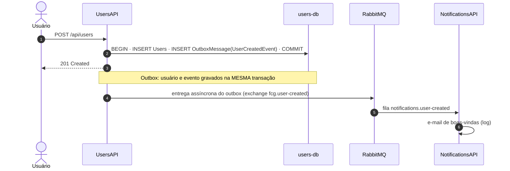
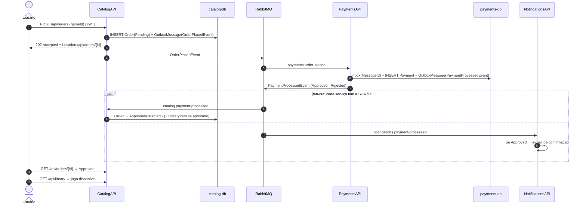
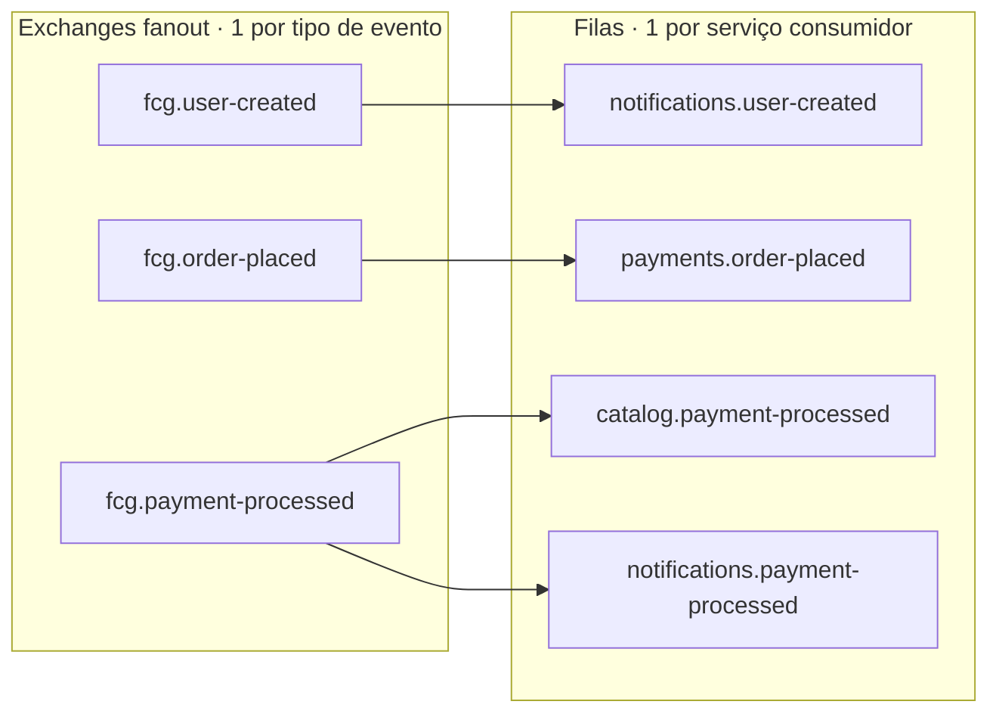
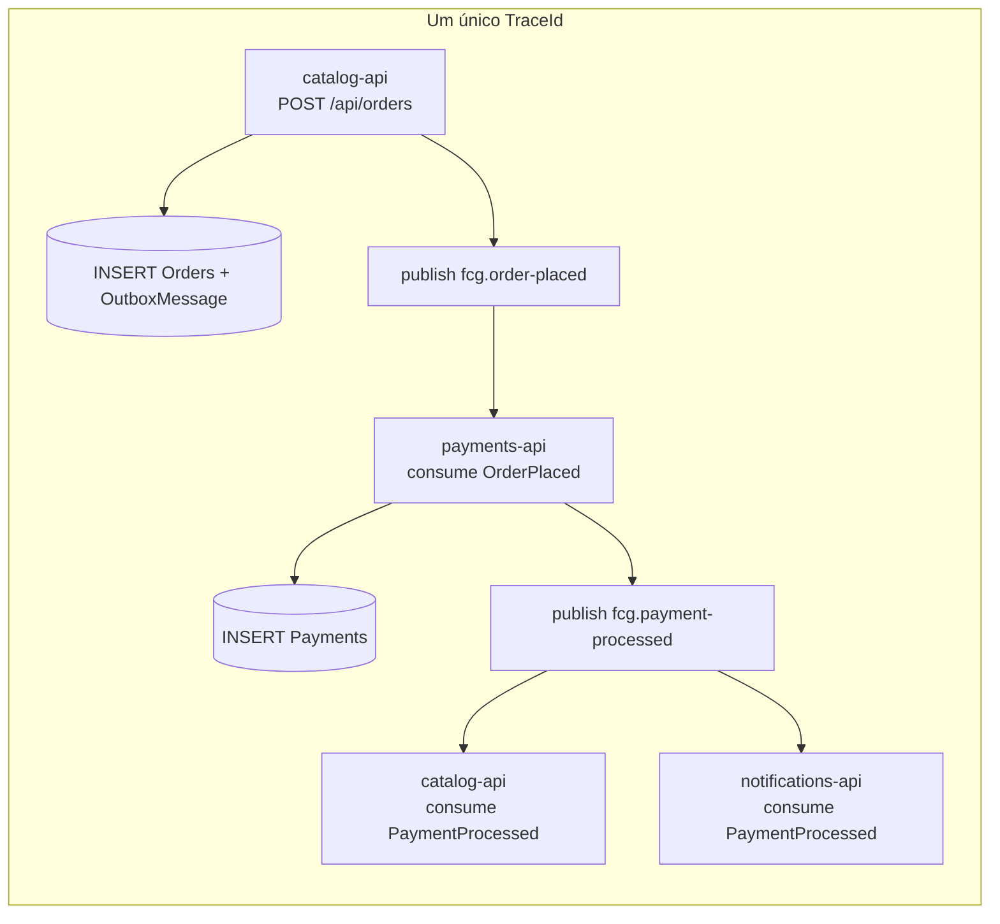
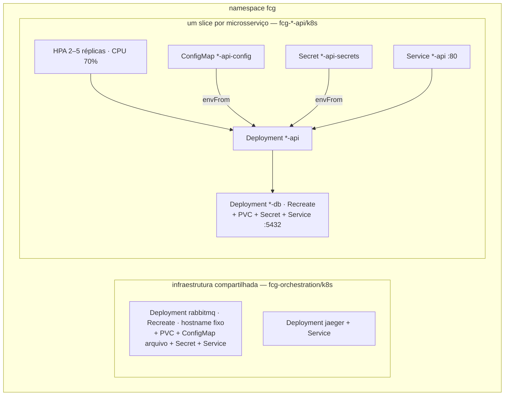

# Arquitetura — FIAP Cloud Games (Fase 2)

> Do monólito a quatro microsserviços orientados a eventos, cada um com repositório, banco,
> imagem e ciclo de vida próprios. Este documento explica **o quê** e, principalmente, **por quê**.
> As decisões individuais estão registradas como ADRs em [`docs/adr`](adr).

## 1. Visão geral

```mermaid
flowchart LR
    client([Cliente / Front-end])

    subgraph cluster [Kubernetes · namespace fcg]
        users[UsersAPI<br/>identidade · JWT]
        catalog[CatalogAPI<br/>jogos · pedidos · biblioteca]
        payments[PaymentsAPI<br/>pagamentos simulados]
        notifications[NotificationsAPI<br/>e-mails simulados]

        usersdb[(users-db)]
        catalogdb[(catalog-db)]
        paymentsdb[(payments-db)]
        rabbit{{RabbitMQ}}
        jaeger[(Jaeger<br/>traces)]
    end

    client -->|HTTP + JWT| users
    client -->|HTTP + JWT| catalog
    client -->|HTTP + JWT| payments

    users --- usersdb
    catalog --- catalogdb
    payments --- paymentsdb

    users -- UserCreatedEvent --> rabbit
    catalog -- OrderPlacedEvent --> rabbit
    payments -- PaymentProcessedEvent --> rabbit
    rabbit -- UserCreatedEvent --> notifications
    rabbit -- OrderPlacedEvent --> payments
    rabbit -- PaymentProcessedEvent --> catalog
    rabbit -- PaymentProcessedEvent --> notifications

    catalog -. JWKS: http://users-api/.well-known/jwks.json .-> users
    payments -. JWKS .-> users
    users & catalog & payments & notifications -. OTLP .-> jaeger
```

| Serviço | Responsabilidade | Dados próprios | Publica | Consome |
|---|---|---|---|---|
| **UsersAPI** | Cadastro, autenticação (emissão de JWT), autorização | `Users` | `UserCreatedEvent` | — |
| **CatalogAPI** | CRUD de jogos, início e conclusão da compra, biblioteca | `Games`, `Orders`, `LibraryItems` | `OrderPlacedEvent` | `PaymentProcessedEvent` |
| **PaymentsAPI** | Processar (simular) pagamento | `Payments` | `PaymentProcessedEvent` | `OrderPlacedEvent` |
| **NotificationsAPI** | Enviar (simular) e-mails | — (stateless) | — | `UserCreatedEvent`, `PaymentProcessedEvent` |

A única chamada HTTP entre serviços é a obtenção da **chave pública** de assinatura (JWKS), feita
pelo nome do Service do Kubernetes (`http://users-api:80`), protegida por retry/circuit breaker e cacheada.
Todo o fluxo de negócio é assíncrono.

## 2. Fluxo de cadastro



## 3. Fluxo de compra



**Por que 202 e não 201?** No momento da resposta o pagamento ainda não aconteceu. Devolver 201 com
"compra concluída" seria mentira. 202 + `Location` comunica corretamente a **consistência eventual**:
o cliente acompanha o recurso até ele sair de `Pending`.

**Isso é uma Saga?** Sim, coreografada: não existe orquestrador; cada serviço reage a eventos e o
`Order` no Catalog funciona como o estado local da transação distribuída. A ação compensatória do
fluxo é simples — pagamento recusado ⇒ pedido `Rejected`, nada a desfazer. Se houvesse etapas posteriores
(ex.: emissão de nota fiscal), valeria migrar para uma saga **orquestrada** (state machine do MassTransit).

## 4. Topologia no RabbitMQ

O MassTransit cria a topologia automaticamente. Com `[EntityName]` nos contratos e nomes de fila vindos
do ConfigMap, ela fica legível no painel (http://localhost:15672):



- **Detalhe**: o MassTransit também cria um exchange com o nome de cada fila (binding exchange → exchange → fila). O diagrama omite esse nível.
- **Pub/sub (fan-out)**: `PaymentProcessedEvent` chega ao Catalog e ao Notifications porque cada um tem a sua fila.
- **Competing consumers**: as 2 réplicas do PaymentsAPI leem a MESMA fila; o broker distribui as mensagens.
- **Falhas**: após o retry (500 ms, 2 s, 5 s), a mensagem vai para `<fila>_error` — nada se perde silenciosamente.
- **Armadilha**: evento publicado antes de existir a fila do consumidor é descartado pelo broker (não há
  para onde rotear). Por isso o script de deploy sobe os consumidores antes dos publicadores.

## 5. Consistência: Transactional Outbox + Inbox

O problema clássico (*dual write*): gravar no banco e publicar no broker são duas operações em dois
sistemas. Qualquer ordem falha em algum cenário:

| Ordem | Falha entre as duas operações | Resultado |
|---|---|---|
| publica → grava | banco recusa | evento de algo que não existe |
| grava → publica | processo cai / broker fora | dado salvo, evento perdido para sempre |

**Solução adotada (MassTransit EF Core Outbox):** `Publish()` grava o evento na tabela `OutboxMessage`
do **próprio banco do serviço**, na mesma transação da entidade. Um background service entrega ao RabbitMQ
depois do commit. No consumo, o **Inbox** registra o `MessageId`: se o RabbitMQ reentregar (ele garante
*at-least-once*, não *exactly-once*), a mensagem é descartada.

Defesas em camadas contra efeito duplicado:

| Camada | Users | Catalog | Payments | Notifications |
|---|---|---|---|---|
| Outbox (publicação atômica) | ✔ | ✔ | ✔ | — |
| Inbox (deduplicação por MessageId) | — | ✔ | ✔ | ✖ (sem banco) |
| Regra de negócio idempotente | — | pedido fora de `Pending` é ignorado | pagamento existente é republicado, **nunca recobrado** | — |
| Restrição no banco | e-mail único | 1 pedido `Pending` por usuário+jogo; jogo único por biblioteca | 1 pagamento por pedido | — |

## 5.1 Resiliência (Aula 05)

| Falha | Proteção | Onde |
|---|---|---|
| Postgres oscilou | `EnableRetryOnFailure` (Npgsql) | `AddDbContext` de cada serviço |
| Consumer falhou | retry com **backoff exponencial** (5 tentativas, 200 ms → 10 s) | `AddConfigureEndpointsCallback` |
| Dependência do consumer fora do ar | **circuit breaker** (`UseKillSwitch`): ≥ 15% de falhas ⇒ pausa o consumo por 30 s | `UsingRabbitMq` |
| Mensagem que nunca vai funcionar | **dead letter**: vai para `<fila>_error` após o retry | MassTransit |
| UsersAPI lento/fora no download do JWKS | pipeline padrão do Polly v8: timeout, retry com jitter, circuit breaker | `JwtValidationExtensions` |
| Broker fora durante uma compra | **outbox**: a requisição é aceita, o evento sai quando o broker voltar | ADR-0003 |
| Um serviço consumindo demais | **bulkhead**: `ConcurrentMessageLimit`, `PrefetchCount` e `limits` de CPU/memória por pod | ConfigMap + Deployment |

Detalhes e justificativas: [ADR-0012](adr/0012-resiliencia.md).

## 5.2 Observabilidade (Aula 06)



- **Tracing**: OpenTelemetry nos 4 serviços (ASP.NET Core, HttpClient, MassTransit, Npgsql) → OTLP → **Jaeger**
  (http://localhost:16686). O MassTransit propaga o `traceparent` nos headers, então o trace atravessa o broker.
- **Logs correlacionados**: cada linha de log traz `TraceId`/`SpanId` (escopos do logger) — copie o TraceId do log
  e busque no Jaeger, ou o contrário.
- **Saúde**: `/health/live`, `/health/ready` e `/health` (JSON com o estado do banco e do bus).
- **Métricas** (Prometheus/Grafana): próximo passo — ver §9.

Detalhes: [ADR-0011](adr/0011-observabilidade-com-opentelemetry-e-jaeger.md).

## 6. Segurança

- **JWT RS256 + JWKS.** Apenas o UsersAPI possui a chave privada (Secret). Os demais validam com a chave
  pública obtida em `/.well-known/jwks.json`. Com HS256 (chave simétrica compartilhada), qualquer serviço
  comprometido poderia **emitir** tokens de administrador.
- `ValidAlgorithms = [RS256]` bloqueia ataques de troca de algoritmo (`alg: none`, confusão HS/RS).
- **IDOR**: o `UserId` da compra vem do token, nunca do corpo. Recurso de outro usuário responde 404 (não confirma existência).
- **Preço** vem do banco do catálogo, nunca do cliente.
- Senhas com PBKDF2 (`PasswordHasher` do ASP.NET Core Identity), rehash transparente e mitigação de enumeração por timing no login.
- Administrador só por seed (credenciais em Secret) — a API pública nunca cria Admin.
- **Rate limiting** no login e no cadastro (janela fixa por IP, configurável no ConfigMap) → 429 em Problem Details.
- Containers: imagem chiseled, não-root (UID 1654), `readOnlyRootFilesystem`, `capabilities: drop ALL`, `seccomp RuntimeDefault`.

## 7. Arquitetura interna de cada serviço

```
src/Fcg.<Serviço>.Api/
├── Contracts/Events/   contratos públicos (namespace Fcg.Contracts.Events — idêntico em todos os repos)
├── Domain/             entidades e regras; NÃO depende de nada (nem EF, nem ASP.NET)
├── Application/        casos de uso (handlers/queries), DTOs, Result pattern, portas (interfaces)
├── Infrastructure/     EF Core, MassTransit, JWT, gateways — adapters das portas
└── Presentation/       endpoints HTTP (Minimal APIs) e consumers (também são pontos de entrada)
```

Um projeto por serviço, camadas por pasta (ver ADR-0009). A regra de dependência que **é** garantida: o
Domínio não referencia infraestrutura. A Application usa o `DbContext` diretamente — decisão consciente.

## 8. Kubernetes



| Recurso | Uso no projeto | Aula |
|---|---|---|
| **Deployment** | 9: quatro APIs, três PostgreSQL, RabbitMQ e Jaeger. Nenhum Pod isolado | 5 |
| **Service** (ClusterIP) | nome estável por componente: `users-api:80`, `catalog-db:5432`, `rabbitmq:5672`, `jaeger:4317` | 4 |
| **ConfigMap** | filas, URLs de serviços, limites (como variáveis) e `rabbitmq.conf` (como arquivo) | 4 |
| **Secret** | connection strings, credenciais do broker, chave privada JWT, senha do admin | 4/07 |
| **PersistentVolumeClaim** | dados do Postgres e do RabbitMQ; `emptyDir` para `/tmp` das APIs | 6 |
| **Probes** | startup (tolera o retry do banco), liveness (sem dependências), readiness (dependência indispensável) | 7 |
| **HPA** | 2–5 réplicas por CPU; o Deployment não fixa `replicas` para não brigar com o HPA | 8 |
| **Labels/Annotations** | `app.kubernetes.io/*` nos seletores; `kubernetes.io/change-cause` para `rollout history` | 3/5 |

Por que Deployment também para banco e broker (e os cuidados com `Recreate` e hostname): [ADR-0010](adr/0010-deployment-com-pvc-para-componentes-com-estado.md).
Por que os manifestos existem em cada repositório **e** reunidos no orquestrador: [ADR-0013](adr/0013-repositorio-de-ambiente.md).

Segurança dos pods: imagem chiseled não-root (UID 1654), `runAsNonRoot`, `readOnlyRootFilesystem`,
`allowPrivilegeEscalation: false`, `capabilities: drop ALL`, `seccompProfile: RuntimeDefault`, sem token de ServiceAccount.

## 9. O que ficou fora (e seria o próximo passo)

| Lacuna | Risco | Evolução |
|---|---|---|
| Sem API Gateway (Aula 04) | cliente conhece 3 endereços; autenticação repetida em cada serviço | YARP ou Ingress NGINX com roteamento por path — com réplicas, para não virar ponto único de falha |
| Sem métricas centralizadas | sem alertas nem dashboards | `.WithMetrics(...)` no OpenTelemetry + Prometheus + Grafana (Aula 06) |
| Notifications sem inbox | e-mail duplicado em reentrega | banco próprio + `UseEntityFrameworkOutbox` |
| Migrations no startup da app | acoplamento deploy ↔ schema | `dotnet ef migrations bundle` executado por um `Job` antes do rollout |
| Secrets versionados | vazamento | External Secrets + Azure Key Vault (Aula 07) |
| Broker e bancos em nó único | ponto único de falha | serviços gerenciados ou operators com réplicas |
| Sem PodDisruptionBudget | manutenção do nó derruba as 2 réplicas juntas | PDB com `minAvailable: 1` |
| Sem TLS entre serviços | tráfego interno em texto claro | service mesh com mTLS (Aula 07) |
| PII (e-mail) nos eventos | dado pessoal no broker | projeção local de usuários no Notifications (ADR-0006) |
| CD para nuvem | deploy manual | push no ACR + deploy no AKS pelo GitHub Actions (disciplina de AKS) |
